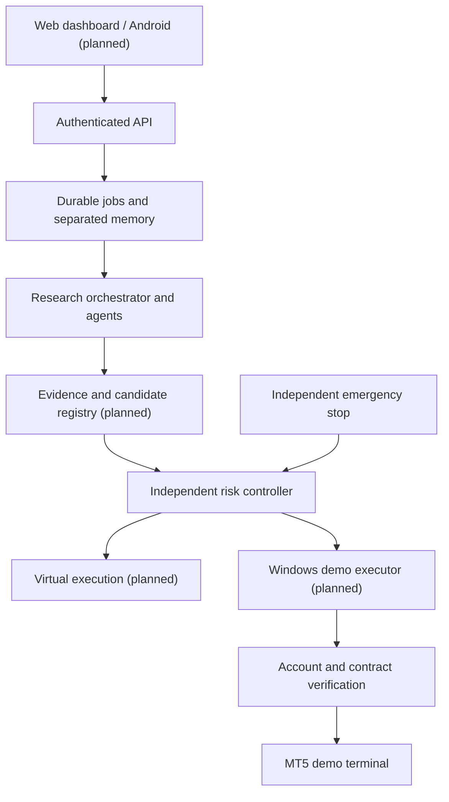

# System architecture

## Deployment and trust boundaries

Start with a modular Python backend rather than 22 independently deployed services.
Separate modules, durable contracts and process boundaries allow later extraction.
FastAPI supplies authenticated administration. A supervised worker runs independently
of ChatGPT. Research output is untrusted input to an independent deterministic risk
service; it can never call the broker directly. The MT5 execution process will be a
separate Windows component with a demo-only allowlist and its own emergency stop.

The diagram shows the target topology. In 0.1.0 there is NO risk-to-broker execution
path, registry, market feed, dashboard, or Android client.

## Logical service map

| # | Service | Boundary / 0.1.0 status |
| --- | --- | --- |
| 1 | AI Orchestrator | Local concurrent task runner implemented; provider orchestration planned |
| 2 | Multi-LLM Gateway | Planned; official OpenAI, Anthropic, xAI APIs, configured model discovery |
| 3 | Market Data Collector | Read-only MT5 port and diagnostic; ingestion planned |
| 4 | Technical Analysis | Simple local sample statistic; indicators planned |
| 5 | Fundamental Analysis | Planned, licensed macro data |
| 6 | News Intelligence | Planned, authorized news/social feeds |
| 7 | Technology Research | Planned, source/license review and isolated experiments |
| 8 | Market Regime Classifier | Descriptive sample label only; validated classifier planned |
| 9 | Strategy Research | Planned, versioned evidence and held-out datasets |
| 10 | Backtesting | Planned, timestamp-safe bid/ask cost-aware simulation |
| 11 | Virtual Trading | Planned; separate memory ready |
| 12 | MT5 Demo Execution | Not implemented; account verification diagnostics only |
| 13 | Risk Management | Hypothetical proposal validation implemented; full portfolio/broker risk planned |
| 14 | Performance Evaluator | Planned, statistical uncertainty and costs |
| 15 | Self-Healing | Planned, diagnosis, challengers, shadow validation |
| 16 | Persistent Memory | Separate SQLite stores, durable records/jobs; PostgreSQL planned |
| 17 | Model Registry | Planned, immutable lineage and owner-reviewed promotion |
| 18 | Notifications | Planned, Telegram/WhatsApp/push authorized APIs |
| 19 | Android Backend | Shared authenticated API foundation; user sessions/WebSockets planned |
| 20 | Web Dashboard | Planned, React/Next.js |
| 21 | CI/CD | Backend workflow written; remote execution unverified |
| 22 | Security and Audit | Bootstrap RBAC, append-only DB audit, local kill switch implemented |

## Durable workflow

SQLite WAL databases separate historical, virtual and demo data. No live database
is created. Schema version 1 is installed transactionally via `aura/store.py`.
No automatic expiry runs. SQL identifiers are allowlisted; payloads are bound values.
The audit table refuses UPDATE and DELETE at the database trigger layer. A filesystem
administrator can still alter the DB; this is not a tamper-proof external audit sink.

Jobs have unique idempotency keys, payload collision rejection, transactional claims,
worker leases with fencing tokens, exponential retry and a dead-letter state after
three acknowledged failures. Expired leases can be reclaimed after restart. Delivery
is at least once: a crash after saving evidence but before acknowledgement can create
another research record. It cannot create an order because no order executor exists.
Durable order-intent reconciliation and an atomic risk reservation are mandatory before
any demo order send is implemented. Queue processing is bounded/manual in this release,
not a continuously supervised scheduler.

## Provider gateway contract (future milestone)

A provider adapter will consume an analysis request containing request ID, role,
source timestamps, schema version, model ID and token/cost budget. It returns validated
structured evidence, provider/model version, token usage, latency and costs. Discover
models from official docs/APIs at setup; no speculative model names are embedded here.
Timeouts, bounded retries, circuit breakers, credential isolation, per-provider cost
limits and fallback must be tested. Provider failures produce NO TRADE. The local
runner is a deterministic research fallback, not a hidden replacement for an LLM.
No provider API is called or authenticated by this checkpoint.

## Production path

PostgreSQL schemas and least-privilege roles will replace local SQLite. Redis may
accelerate delivery, but PostgreSQL outbox/order intent records remain authoritative.
Windows services or a verified supervisor run the backend and research worker. The
MT5 terminal and bridge use a documented Windows user session; unattended recovery
must be proved on the actual VPS rather than assumed to work in Session 0.

Expose only a TLS reverse proxy through a private VPN initially. API binds loopback.
External identity, MFA, rate/request limits, key rotation, structured redacted logging,
metrics and encrypted backups are release requirements. AI keys and MT5 credentials
stay on the backend, never in Android or browser bundles.

## Safety invariants

Live mode is rejected during configuration. No order endpoint or order-send method
exists. The kill switch starts ON and persists across restart. Risk-state failure
blocks eligibility. A research eligibility result always includes execution_allowed=false.
Unvalidated client-provided price ages, costs and position counts must never be trusted
by the eventual executor. It must read fresh broker facts itself.

No strategy promotion based solely on win rate or maturity is allowed. Fresh held-out,
walk-forward and shadow evidence are required. Code changes cannot modify risk policy
autonomously. Demo activation and executable trading deployment require explicit review.
